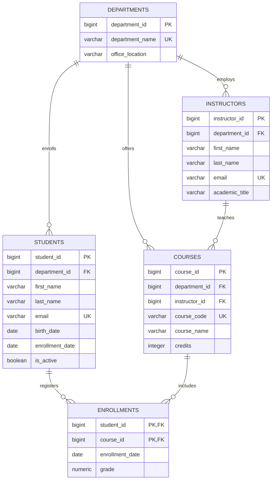

# 🎓 Bölüm 1: Üniversite Veritabanı Tasarımı (University Database Schema)

Bu modülde ilişkisel veritabanı (RDBMS) temelleri, tablo ilişkileri (`1:N`, `M:N`), veri tipleri ve referential integrity kuralları (`ON DELETE RESTRICT / CASCADE`) kullanılarak PostgreSQL üzerinde bir üniversite veritabanı şeması tasarlanmıştır.

## 📐 Entity-Relationship (ER) Diyagramı

## 🔒 Uygulanan Kısıtlamalar (Constraints & Kurallar)
- **Primary Keys:** Tekil tablolarda `BIGINT GENERATED ALWAYS AS IDENTITY`, ara tabloda (`enrollments`) `(student_id, course_id)` **Composite Primary Key** kullanıldı.
- **Unique:** Bölüm adları, ders kodları ve öğrenci/öğretim üyesi e-posta adresleri benzersiz (`UNIQUE`) tanımlandı.
- **Check Constraints:** Ders kredileri `1 ile 10` arasında, öğrenci notları `0 ile 100` arasında sınırlandırıldı.
- **Referential Actions:**
  - `ON DELETE RESTRICT`: Öğrencisi, hocası veya dersi bulunan bir bölümün yanlışlıkla silinmesi engellendi.
  - `ON DELETE CASCADE`: Öğrenci kaydı silindiğinde ilgili ders kayıtlarının (`enrollments`) otomatik temizlenmesi sağlandı.
